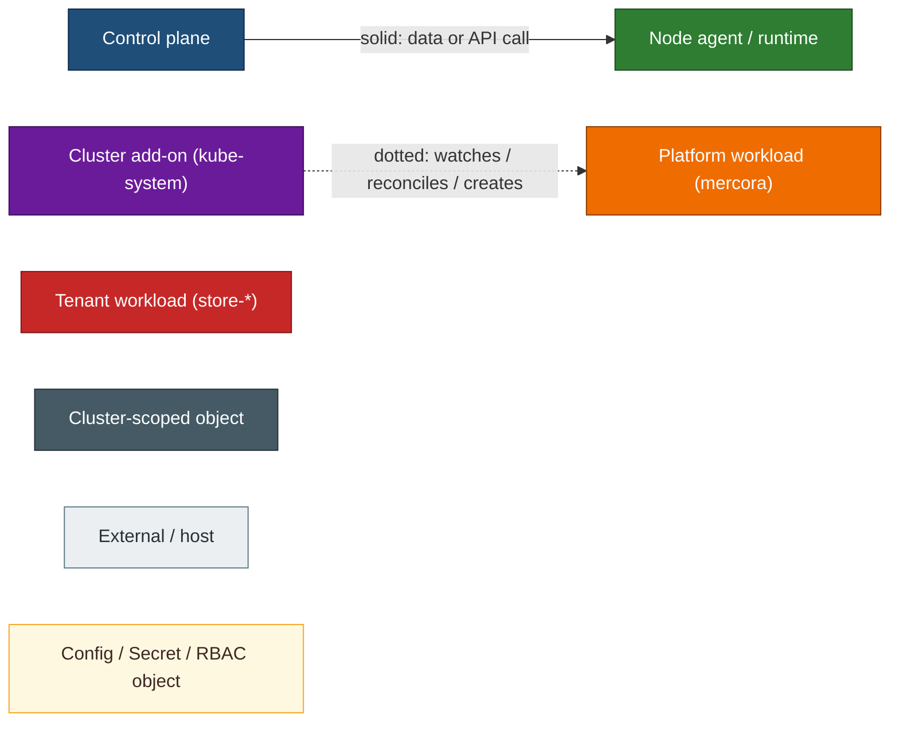
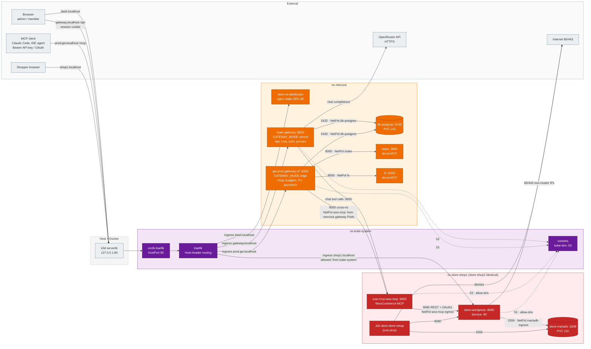

# Cluster architecture: k3d `store-check`

Snapshot taken live on 2026-10-15 from context `k3d-store-check`. Every object
below exists in the cluster. Items from the generic "production" template that do
**not** exist here are listed in [Template gap](#template-gap) and are not drawn.

| Fact | Value |
|---|---|
| Distribution | k3s v1.35.5+k3s1 inside k3d (Docker Desktop, macOS) |
| Topology | 1 server node `k3d-store-check-server-0` (172.23.0.3), control-plane role, untainted, so it also runs every workload. No agent nodes, no node pools |
| Datastore | kine over SQLite (`/var/lib/rancher/k3s/server/db/state.db`). No etcd, no quorum |
| Runtime | containerd 2.2.3-k3s1 |
| CNI | flannel (vxlan), Pod CIDR 10.42.0.0/16, Service CIDR 10.43.0.0/16 |
| NetworkPolicy | k3s embedded kube-router policy controller |
| Service proxy | kube-proxy embedded in k3s (iptables) |
| Ingress | Traefik 3.6.13 (k3s HelmChart), IngressClass `traefik` |
| LoadBalancer | k3s ServiceLB (klipper-lb DaemonSet `svclb-traefik`) |
| Storage | `local-path` StorageClass (default), hostPath volumes on the node |
| Secrets | Native Kubernetes Secrets, made by hand or by Helm / the operator |
| GitOps / observability | None. Deploys are manual `helm upgrade`; metrics-server only |
| Host ports | `0.0.0.0:80` → node :80 (HTTP), `0.0.0.0:61040` → apiserver :6443 |

---

## Legend

---

## 1. Cluster topology

```mermaid
flowchart TB
  subgraph EXT["External / host: macOS + Docker Desktop"]
    dev["Developer laptop<br/>kubectl, helm, k3d CLI<br/>docker build"]
    browser["Browser and MCP clients<br/>*.localhost resolves to 127.0.0.1"]
    dockerhub["Docker Hub registry-1.docker.io<br/>bitnami/wordpress:latest<br/>bitnami/mariadb:latest<br/>postgres:17-alpine"]
    rancher["Rancher mirrored images<br/>coredns, traefik, metrics-server,<br/>local-path-provisioner, klipper-lb/helm"]
    openrouter["OpenRouter API (HTTPS)<br/>chat LLM_MODEL + guard model"]
    internet["Public internet 80/443<br/>WordPress plugin + theme downloads"]
  end

  subgraph DOCKER["Docker network: k3d-store-check"]
    serverlb["k3d-store-check-serverlb (nginx)<br/>host :80 to node :80<br/>host :61040 to node :6443"]
    tools["k3d-store-check-tools<br/>k3d image import helper"]

    subgraph NODE["Node k3d-store-check-server-0 · 172.23.0.3<br/>roles: control-plane · untainted · runs all Pods<br/>single k3s server process"]
      subgraph CP["Control plane (embedded in k3s)"]
        api["kube-apiserver<br/>:6443 TLS<br/>authn, authz RBAC, admission"]
        kine["kine to SQLite<br/>state.db<br/>no etcd, no quorum, no HA"]
        sched["kube-scheduler<br/>binds Pods to the one node"]
        kcm["kube-controller-manager<br/>Deployment, ReplicaSet, StatefulSet,<br/>Job, EndpointSlice, Namespace, GC"]
        ccm["k3s cloud-controller-manager<br/>node addresses + ServiceLB"]
        helmctl["k3s helm-controller<br/>reconciles HelmChart CRs"]
        deployctl["k3s deploy controller<br/>applies /var/lib/rancher/k3s/server/manifests"]
      end

      subgraph AGENT["Node agent (embedded in k3s)"]
        kubelet["kubelet :10250<br/>Pod lifecycle, probes, volumes"]
        containerd["containerd 2.2.3 (CRI)<br/>image store, runc shims"]
        kproxy["kube-proxy (embedded)<br/>iptables Service VIPs 10.43.0.0/16"]
        flannel["flannel CNI vxlan<br/>Pod IPs 10.42.0.0/16"]
        kr["kube-router policy controller<br/>enforces NetworkPolicy via iptables"]
        lpath["/var/lib/rancher/k3s/storage<br/>hostPath backing for local-path PVs"]
      end

      subgraph ADDONS["Add-ons · namespace kube-system"]
        svclb["DaemonSet svclb-traefik<br/>klipper-lb, hostPort 80 + 443"]
        traefik["Deployment traefik 3.6.13<br/>Ingress controller"]
        coredns["Deployment coredns 1.14.3<br/>Service kube-dns 10.43.0.10:53"]
        metrics["Deployment metrics-server 0.8.1<br/>Service :443, APIService metrics.k8s.io"]
        lpp["Deployment local-path-provisioner 0.0.36<br/>StorageClass local-path"]
      end

      subgraph WORK["Workloads"]
        mercora["namespace mercora<br/>platform: gateways, dashboard,<br/>operator, Postgres, demo MCPs"]
        shop1["namespace store-shop1<br/>WordPress + MariaDB + woo-mcp"]
        shop2["namespace store-shop2<br/>WordPress + MariaDB + woo-mcp"]
      end
    end
  end

  dev -->|"kubectl / helm over :61040"| serverlb
  dev -->|"k3d image import"| tools
  tools -->|"ctr import"| containerd
  browser -->|"HTTP :80"| serverlb
  serverlb -->|":6443"| api
  serverlb -->|":80"| svclb
  svclb --> traefik
  traefik --> mercora
  traefik --> shop1
  traefik --> shop2

  api <--> kine
  sched -->|"watch + bind"| api
  kcm -->|"watch + reconcile"| api
  ccm --> api
  helmctl --> api
  deployctl --> api
  kubelet -->|"watch Pods, report status, Lease"| api
  kubelet --> containerd
  kubelet --> flannel
  kproxy -->|"watch Services, EndpointSlices"| api
  kr -->|"watch NetworkPolicies"| api
  lpp -->|"provision dirs"| lpath
  metrics -->|"scrape /metrics/resource"| kubelet

  containerd -.->|"pull"| dockerhub
  containerd -.->|"pull"| rancher
  mercora -.->|"HTTPS chat"| openrouter
  shop1 -.->|"80/443 egress"| internet
  shop2 -.->|"80/443 egress"| internet

  classDef cp fill:#1f4e79,stroke:#0d2a44,color:#ffffff
  classDef node fill:#2e7d32,stroke:#1b4d1f,color:#ffffff
  classDef addon fill:#6a1b9a,stroke:#3d0f59,color:#ffffff
  classDef plat fill:#ef6c00,stroke:#8a3e00,color:#ffffff
  classDef tenant fill:#c62828,stroke:#7a1818,color:#ffffff
  classDef ext fill:#eceff1,stroke:#607d8b,color:#263238
  class api,kine,sched,kcm,ccm,helmctl,deployctl cp
  class kubelet,containerd,kproxy,flannel,kr,lpath node
  class svclb,traefik,coredns,metrics,lpp addon
  class mercora plat
  class shop1,shop2 tenant
  class dev,browser,dockerhub,rancher,openrouter,internet,serverlb,tools ext

  style EXT fill:#fafafa,stroke:#90a4ae
  style DOCKER fill:#f5f5f5,stroke:#90a4ae,stroke-dasharray: 4 3
  style NODE fill:#e8f5e9,stroke:#2e7d32
  style CP fill:#e3f2fd,stroke:#1f4e79
  style AGENT fill:#f1f8e9,stroke:#2e7d32
  style ADDONS fill:#f3e5f5,stroke:#6a1b9a
  style WORK fill:#fff3e0,stroke:#ef6c00
```

---

## 2. Namespace and object map

Helm release Secrets (`sh.helm.release.v1.*`) and the auto-made
`kube-root-ca.crt` ConfigMap exist in every namespace that has them; they are
counted in the table, not drawn as boxes.

```mermaid
flowchart TB
  subgraph CS["Cluster-scoped"]
    nodes["Node<br/>k3d-store-check-server-0"]
    nsobj["Namespaces (7)<br/>default, kube-system, kube-public,<br/>kube-node-lease, mercora,<br/>store-shop1, store-shop2"]
    sc["StorageClass local-path (default)<br/>provisioner rancher.io/local-path"]
    pv["PersistentVolumes (5) · 1Gi RWO each<br/>bound to db-postgres, 2x mariadb,<br/>2x wordpress PVCs"]
    ic["IngressClass traefik<br/>traefik.io/ingress-controller"]
    pc["PriorityClasses<br/>store-workload (-100)<br/>system-cluster-critical, system-node-critical"]
    crdmine["CRDs mcpgateway.example.com<br/>Store, McpGateway, HostedServer"]
    crdother["CRDs third-party<br/>traefik.io (11), hub.traefik.io (13),<br/>gateway.networking.k8s.io (6),<br/>helm.cattle.io (2), k3s.cattle.io (2)"]
    cr["ClusterRoles (non-system)<br/>mercora-store-operator<br/>traefik-kube-system<br/>local-path-provisioner-role<br/>k3s-cloud-controller-manager<br/>admin, edit, view, cluster-admin"]
    crb["ClusterRoleBindings (non-system)<br/>mercora-store-operator<br/>traefik-kube-system, helm-kube-system-traefik(-crd)<br/>local-path-provisioner-bind<br/>k3s-cloud-controller-manager(-auth-delegator)<br/>kube-apiserver-kubelet-admin, cluster-admin"]
    wh["Admission webhooks<br/>none (no Mutating/Validating configs)"]
  end

  subgraph NSD["ns default"]
    d_svc["Service kubernetes<br/>ClusterIP 10.43.0.1:443"]
    d_sa["ServiceAccount default"]
  end

  subgraph NSP["ns kube-public"]
    p_obj["ServiceAccount default<br/>Role + RoleBinding<br/>system:controller:bootstrap-signer"]
  end

  subgraph NSL["ns kube-node-lease"]
    l_obj["Lease k3d-store-check-server-0<br/>(node heartbeat)<br/>ServiceAccount default"]
  end

  subgraph NSK["ns kube-system"]
    k_dep["Deployments<br/>coredns, traefik,<br/>metrics-server, local-path-provisioner"]
    k_ds["DaemonSet svclb-traefik-88598cc8"]
    k_job["Jobs (Complete)<br/>helm-install-traefik<br/>helm-install-traefik-crd"]
    k_svc["Services<br/>kube-dns ClusterIP 10.43.0.10 :53 udp/tcp, :9153<br/>metrics-server ClusterIP :443<br/>traefik LoadBalancer 172.23.0.3<br/>80:30413, 443:30707"]
    k_hc["HelmCharts<br/>traefik, traefik-crd"]
    k_cm["ConfigMaps<br/>coredns, cluster-dns, local-path-config,<br/>chart-content-traefik(-crd),<br/>extension-apiserver-authentication"]
    k_sec["Secrets<br/>k3s-serving (TLS), node-password,<br/>chart-values-traefik(-crd)"]
    k_rbac["ServiceAccounts: ~45 controller SAs<br/>+ coredns, traefik, svclb, metrics-server,<br/>local-path-provisioner, helm-traefik(-crd)<br/>Roles/RoleBindings: leader-locking,<br/>apiserver-auth-reader, bootstrap, token-cleaner"]
  end

  subgraph NSM["ns mercora · platform (default-deny)"]
    m_dep["Deployments<br/>team-gateway 1/1 · gateway:0.8.9 (control)<br/>gw-prod-gateway 2/2 · gateway:0.8.5 (edge)<br/>team-ui-dashboard 1/1 · dashboard:0.8.6<br/>store-operator 1/1 · store-operator:0.5.2<br/>notes 1/1, fx 1/1 · demo-mcp:0.1.0"]
    m_sts["StatefulSet db-postgres 1/1<br/>postgres:17-alpine"]
    m_svc["Services (ClusterIP)<br/>team-gateway :8000, gw-prod-gateway :8000<br/>team-ui-dashboard :80, db-postgres :5432<br/>notes :8000, fx :8000"]
    m_ing["Ingress (class traefik)<br/>gateway.localhost to team-gateway<br/>prod.gw.localhost to gw-prod-gateway<br/>dash.localhost to team-ui-dashboard"]
    m_pvc["PVC data-db-postgres-0 · 1Gi local-path"]
    m_np["NetworkPolicies<br/>default-deny, acme-solver-ingress<br/>db-postgres: in 5432 from gateway Pods<br/>notes, fx: in 8000 from gateway Pods"]
    m_cm["ConfigMap db-postgres-init"]
    m_sec["Secrets (user-made)<br/>gateway-db, gateway-admin,<br/>gateway-credentials<br/>(chart-made) notes-mcp-credentials, fx-mcp-credentials"]
    m_rbac["ServiceAccounts<br/>team-gateway, store-operator, default<br/>Role + RoleBinding team-gateway-stores<br/>get/list/create/delete stores, mcpgateways, hostedservers"]
    m_cr["Custom resources<br/>McpGateway prod (Ready, http://prod.gw.localhost)<br/>Store shop1, Store shop2 (Ready, template blank)"]
    m_helm["Helm releases<br/>team, team-ui, gw-prod, store-operator,<br/>db, notes, fx"]
  end

  subgraph NS1["ns store-shop1 · tenant (default-deny)"]
    s1_dep["Deployments<br/>store-wordpress · bitnami/wordpress:latest<br/>woo-mcp-woo-mcp · woo-mcp:0.4.0"]
    s1_sts["StatefulSet store-mariadb<br/>bitnami/mariadb:latest"]
    s1_job["Job store-store-setup (Complete)<br/>installs WooCommerce, API keys"]
    s1_svc["Services<br/>store-wordpress ClusterIP :80/:443<br/>store-mariadb ClusterIP :3306<br/>store-mariadb-headless (None) :3306<br/>woo-mcp-woo-mcp ClusterIP :8000"]
    s1_ing["Ingress shop1.localhost to store-wordpress"]
    s1_pvc["PVCs 1Gi local-path<br/>data-store-mariadb-0, store-wordpress"]
    s1_np["NetworkPolicies (7)<br/>default-deny, allow-dns,<br/>mariadb-ingress, wordpress-ingress,<br/>wordpress-egress, setup-egress, woo-mcp-woo-mcp"]
    s1_q["ResourceQuota store-quota<br/>pods 10, req cpu 1, req mem 2Gi,<br/>lim mem 3Gi, PVCs 2, storage 3Gi<br/>LimitRange store-limits<br/>default mem 512Mi, max 1Gi, req 50m/64Mi"]
    s1_pdb["PDBs maxUnavailable 1<br/>store-mariadb, store-wordpress"]
    s1_cfg["ConfigMaps store-mariadb, store-store-setup<br/>Secrets store-mariadb, woo-mcp-credentials<br/>SAs store-mariadb, store-wordpress, default<br/>Roles: none"]
    s1_helm["Helm releases store, woo-mcp<br/>installed by store-operator"]
  end

  subgraph NS2["ns store-shop2 · tenant (default-deny)"]
    s2_all["Identical object set to store-shop1<br/>(same charts, same names)<br/>Ingress shop2.localhost"]
  end

  sc -.-> pv
  pv -.->|"bound"| m_pvc
  pv -.->|"bound"| s1_pvc
  ic -.-> m_ing
  ic -.-> s1_ing
  pc -.->|"priorityClassName"| s1_dep
  crdmine -.-> m_cr
  cr -.->|"bound to SA store-operator"| m_rbac
  m_cr -.->|"operator creates"| NS1
  m_cr -.->|"operator creates"| NS2

  classDef cp fill:#1f4e79,stroke:#0d2a44,color:#ffffff
  classDef addon fill:#6a1b9a,stroke:#3d0f59,color:#ffffff
  classDef plat fill:#ef6c00,stroke:#8a3e00,color:#ffffff
  classDef tenant fill:#c62828,stroke:#7a1818,color:#ffffff
  classDef cluster fill:#455a64,stroke:#263238,color:#ffffff
  classDef cfg fill:#fff8e1,stroke:#f9a825,color:#3e2723
  class nodes,nsobj,sc,pv,ic,pc,crdmine,crdother,cr,crb,wh cluster
  class d_svc,d_sa,p_obj,l_obj cp
  class k_dep,k_ds,k_job,k_svc,k_hc addon
  class k_cm,k_sec,k_rbac cfg
  class m_dep,m_sts,m_svc,m_ing,m_pvc,m_cr,m_helm plat
  class m_np,m_cm,m_sec,m_rbac cfg
  class s1_dep,s1_sts,s1_job,s1_svc,s1_ing,s1_pvc,s1_helm,s2_all tenant
  class s1_np,s1_q,s1_pdb,s1_cfg cfg

  style CS fill:#eceff1,stroke:#455a64
  style NSD fill:#e3f2fd,stroke:#1f4e79
  style NSP fill:#e3f2fd,stroke:#1f4e79
  style NSL fill:#e3f2fd,stroke:#1f4e79
  style NSK fill:#f3e5f5,stroke:#6a1b9a
  style NSM fill:#fff3e0,stroke:#ef6c00
  style NS1 fill:#ffebee,stroke:#c62828
  style NS2 fill:#ffebee,stroke:#c62828
```

### Namespace inventory

| Namespace | Owner / purpose | Workloads | Services | Ingress | Storage | Policy & limits | Config, Secrets, RBAC |
|---|---|---|---|---|---|---|---|
| `default` | Kubernetes built-in | none | `kubernetes` ClusterIP 10.43.0.1:443 (apiserver VIP) | none | none | none | SA `default` |
| `kube-public` | Built-in, world-readable | none | none | none | none | none | SA `default`; Role/RoleBinding `system:controller:bootstrap-signer` |
| `kube-node-lease` | Built-in node heartbeats | none | none | none | none | none | Lease `k3d-store-check-server-0`; SA `default` |
| `kube-system` | k3s add-ons | Deploy `coredns`, `traefik`, `metrics-server`, `local-path-provisioner`; DS `svclb-traefik-88598cc8`; Jobs `helm-install-traefik`, `helm-install-traefik-crd` | `kube-dns` ClusterIP :53/:9153; `metrics-server` ClusterIP :443; `traefik` LoadBalancer 172.23.0.3 80/443 (NodePorts 30413/30707) | none | none | none | CM `coredns`, `cluster-dns`, `local-path-config`, `chart-content-traefik(-crd)`, `extension-apiserver-authentication`, `kube-apiserver-legacy-service-account-token-tracking`; Secrets `k3s-serving`, node-password, `chart-values-traefik(-crd)`, 2 Helm release; HelmCharts `traefik`, `traefik-crd`; ~55 SAs; 6 Roles, 8 RoleBindings |
| `mercora` | MCP gateway platform | Deploy `team-gateway` (control, 1), `gw-prod-gateway` (edge, 2), `team-ui-dashboard`, `store-operator`, `notes`, `fx`; STS `db-postgres` | ClusterIP `team-gateway`:8000, `gw-prod-gateway`:8000, `team-ui-dashboard`:80, `db-postgres`:5432, `notes`:8000, `fx`:8000 | `gateway.localhost`, `prod.gw.localhost`, `dash.localhost` | PVC `data-db-postgres-0` 1Gi | NetPol `default-deny`, `acme-solver-ingress`, `db-postgres`, `notes`, `fx` (ingress only from `app.kubernetes.io/name=gateway`), plus one per component. No quota | CM `db-postgres-init`; Secrets `gateway-db`, `gateway-admin`, `gateway-credentials`, `notes-mcp-credentials`, `fx-mcp-credentials`, 47 Helm release; SAs `team-gateway`, `store-operator`; Role/RB `team-gateway-stores`; CRs McpGateway `prod`, Store `shop1`, `shop2` |
| `store-shop1` | Tenant store, made by operator from Store `shop1` | Deploy `store-wordpress`, `woo-mcp-woo-mcp`; STS `store-mariadb`; Job `store-store-setup` | ClusterIP `store-wordpress`:80/443, `store-mariadb`:3306, `woo-mcp-woo-mcp`:8000; Headless `store-mariadb-headless` | `shop1.localhost` | PVC `data-store-mariadb-0`, `store-wordpress` (1Gi each) | NetPol ×7 incl. `default-deny`; ResourceQuota `store-quota`; LimitRange `store-limits`; PDB `store-mariadb`, `store-wordpress`; PriorityClass `store-workload` | CM `store-mariadb`, `store-store-setup`; Secrets `store-mariadb`, `woo-mcp-credentials`, 2 Helm release; SAs `store-mariadb`, `store-wordpress` |
| `store-shop2` | Tenant store, Store `shop2` | same as shop1 | same as shop1 | `shop2.localhost` | same as shop1 | same as shop1 | same as shop1 |
| `mcp-<name>` | Made on demand per HostedServer CR | none exist right now | | | | | |

Objects that exist in **no** namespace right now: HPA, CronJob, NodePort-only
Service, admission webhooks, Roles in tenant namespaces.

---

## 3. Request traffic flow

Arrows show only paths the NetworkPolicies allow. `mercora` is default-deny too;
each Pod reaches only what its own policy allows.

Notes:
- The dashboard nginx does not proxy `/api`; the SPA calls `gateway.localhost` directly from the browser.
- Blocked by policy: anything into `store-*` except Traefik → WordPress and mercora gateway Pods → woo-mcp; WordPress → woo-mcp; woo-mcp → internet; MariaDB egress.

---

## 4. Deploy and control-loop flow

```mermaid
flowchart TB
  subgraph DEV["Developer (manual, no CI, no GitOps)"]
    code["Repo team-mcp-gateway<br/>services/* + charts/*"]
    build["docker build<br/>gateway, dashboard, woo-mcp,<br/>store-operator, demo-mcp"]
    import["k3d image import -c store-check"]
    helmcli["helm upgrade --install<br/>releases: team, team-ui,<br/>store-operator, db, gw-prod (by hand)"]
    crdapply["kubectl apply crds/*.yaml<br/>(helm never upgrades crds/)"]
    restart["kubectl rollout restart<br/>(image tags get reused)"]
  end

  subgraph CP["Control plane"]
    api["kube-apiserver"]
    store[("kine / SQLite")]
    kcm["kube-controller-manager<br/>Deployment to ReplicaSet to Pod<br/>StatefulSet, Job, EndpointSlice"]
    sched["kube-scheduler"]
    helmctl["k3s helm-controller<br/>HelmChart traefik"]
  end

  subgraph NODE["Node agent"]
    kubelet["kubelet"]
    cri["containerd"]
    kproxy["kube-proxy + kube-router<br/>Service and NetPol rules"]
  end

  subgraph MC["ns mercora"]
    ctl["team-gateway<br/>SA team-gateway<br/>Role team-gateway-stores"]
    op["store-operator (kopf)<br/>SA store-operator<br/>ClusterRole mercora-store-operator<br/>bundles helm + charts gateway, store, woo-mcp"]
    crs["Custom resources<br/>Store · McpGateway · HostedServer"]
    edgerel["Helm release gw-slug<br/>edge gateway Deployment,<br/>Service, Ingress slug.gw.localhost"]
  end

  subgraph TEN["Tenant namespaces made by operator"]
    nsstore["store-name<br/>Namespace, ResourceQuota, LimitRange,<br/>NetworkPolicies, then helm store + woo-mcp,<br/>setup Job"]
    nsmcp["mcp-name<br/>Namespace, Deployment, Service<br/>for a HostedServer"]
  end

  admin["Admin in dashboard<br/>create store / gateway / hosted server"]

  code --> build --> import --> cri
  helmcli -->|"apply manifests"| api
  crdapply --> api
  restart --> api

  api <--> store
  kcm -->|"watch / reconcile"| api
  sched -->|"bind Pods"| api
  helmctl -->|"reconcile"| api
  kubelet -->|"watch assigned Pods,<br/>status + Lease"| api
  kubelet --> cri
  kproxy -->|"watch"| api

  admin -->|"POST /api/stores etc."| ctl
  ctl -->|"create / delete CR"| crs
  crs -.->|"kopf watch"| op
  op -->|"create ns + guard rails"| nsstore
  op -->|"helm upgrade --install store, woo-mcp"| nsstore
  op -->|"helm upgrade --install gw-slug"| edgerel
  op -->|"create ns, Deployment, Service"| nsmcp
  op -->|"POST/PATCH/DELETE /api/servers<br/>SA token, TokenReview"| ctl
  op -->|"patch status.phase Ready"| crs

  classDef cp fill:#1f4e79,stroke:#0d2a44,color:#ffffff
  classDef node fill:#2e7d32,stroke:#1b4d1f,color:#ffffff
  classDef plat fill:#ef6c00,stroke:#8a3e00,color:#ffffff
  classDef tenant fill:#c62828,stroke:#7a1818,color:#ffffff
  classDef ext fill:#eceff1,stroke:#607d8b,color:#263238
  class api,store,kcm,sched,helmctl cp
  class kubelet,cri,kproxy node
  class ctl,op,crs,edgerel plat
  class nsstore,nsmcp tenant
  class code,build,import,helmcli,crdapply,restart,admin ext

  style DEV fill:#fafafa,stroke:#90a4ae
  style CP fill:#e3f2fd,stroke:#1f4e79
  style NODE fill:#e8f5e9,stroke:#2e7d32
  style MC fill:#fff3e0,stroke:#ef6c00
  style TEN fill:#ffebee,stroke:#c62828
```

---

## External dependencies

| Dependency | Used by | Notes |
|---|---|---|
| Git (local repo) | developer | No remote CI or GitOps watching it |
| CI/CD | none | Builds, imports and `helm upgrade` are manual |
| Image registries | containerd | Docker Hub (bitnami, postgres), Rancher mirrors (k3s add-ons); own images come via `k3d image import`, no registry |
| Identity provider | none | Gateway does its own users, sessions, API keys, OAuth |
| Cloud API | none | k3s cloud-controller-manager only sets node addresses and ServiceLB |
| DNS | host | `*.localhost` resolves to 127.0.0.1; in-cluster CoreDNS |
| LLM | team-gateway | OpenRouter via `OPENROUTER_API_KEY` in Secret `gateway-admin` |
| Internet egress | WordPress, setup Job | 80/443 to non-cluster IPs for plugins and themes |
| Observability SaaS | none | metrics-server only |

---

## Template gap

What the generic production template asked for vs. what this cluster has.

| Template item | Here |
|---|---|
| 3 HA control-plane nodes, etcd quorum | 1 server, SQLite via kine. Losing the node loses the cluster |
| Worker pools (general, memory, GPU) | none; workloads share the control-plane node |
| Cilium (kube-proxy replacement) | flannel + embedded kube-proxy + kube-router NetPol |
| ingress-nginx | Traefik (k3s bundled) |
| cert-manager, external-dns | absent. Operator has a `CLUSTER_ISSUER` env and `deploy/tls-prod.yaml` exists for prod, unused locally |
| ArgoCD | absent |
| EBS gp3 CSI | `local-path` hostPath, node-bound, no snapshots |
| External Secrets Operator | absent; hand-made Secrets |
| kube-prometheus-stack, Loki | absent |
| Namespaces `ingress-nginx`, `cert-manager`, `monitoring`, `logging`, `argocd`, `apps-prod`, `apps-dev`, `data` | none exist. Their roles map to: `kube-system` (ingress), `mercora` (apps + Postgres), `store-*` (tenant apps + MariaDB) |
| HPA, CronJobs, webhooks | none |

## Things this map surfaced

- `mercora` has no ResourceQuota or LimitRange, unlike the tenant namespaces. It is default-deny, and each component has its own NetworkPolicy.
- Tenant images use `bitnami/*:latest`, so a Pod restart can pull a different version.
- `gw-prod-gateway` runs no explicit ServiceAccount (uses `default`) while `team-gateway` has its own.
- At snapshot time `store-wordpress` in both stores was `0/1` Running (readiness pending right after the cluster start).
